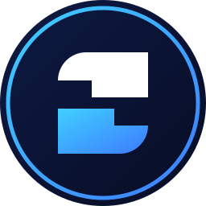

<p align="center"></p>

# SDBR · Solidity Brasil

Smart contracts of **SDBR**, deployed on **BNB Smart Chain** (home chain, where the liquidity lives) and bridged to other EVM chains. the utility token of [Solidity Brasil](https://soliditybrasil.com.br). SDBR pays for Solidity Brasil products: websites, landing pages, AI agents, messaging and blockchain tools.

- **Website:** https://sdbr.soliditybrasil.com.br
- **Whitepaper:** [docs/SDBR-whitepaper-v1.pdf](docs/SDBR-whitepaper-v1.pdf)
- **X:** https://x.com/sdbrtoken · **Telegram:** https://t.me/sdbrtoken · **Medium:** https://medium.com/solidity-brasil
- **Contact:** disley@soliditybrasil.com.br

## Technology Stack

- **Blockchain:** BNB Smart Chain (home chain, chain ID 56) + EVM-compatible chains via LayerZero v2
- **Smart contracts:** Solidity 0.8.26, OpenZeppelin 5, LayerZero OFT, Uniswap v4 hooks
- **Development:** Foundry (forge tests on a BNB Smart Chain fork), CreateX CREATE3 for identical addresses
- **Configuration:** [`foundry.toml`](foundry.toml) (`bsc` RPC endpoint), [`bsc.json`](bsc.json) (BNB Smart Chain addresses)

## Supported Networks

| Network | Chain ID | Role |
|---|---|---|
| **BNB Smart Chain Mainnet** | **56** | Home chain: full supply minted here, Uniswap v4 pool and PoolTravada hook |
| Base | 8453 | OFT (bridged) |
| Arbitrum One | 42161 | OFT (bridged) |
| Polygon PoS | 137 | OFT (bridged) |
| OP Mainnet | 10 | OFT (bridged) |
| Avalanche C-Chain | 43114 | OFT (bridged) |
| Celo | 42220 | OFT (bridged) |

## How it works

| | |
|---|---|
| Name / Symbol / Decimals | Solidity Brasil / SDBR / 9 |
| Token address (same on all chains) | `0x00000000001C77283FDB79c1D012930C3c987cbc` |
| Chains | BNB Smart Chain, Base, Arbitrum, Polygon, Optimism, Avalanche, Celo |
| Supply | 1,000,000,000,000,000,000,000 SDBR, fixed (minted once, on BNB Chain) |
| Standard | ERC-20 + ERC-2612 `permit`, LayerZero v2 OFT |

- **100% of the supply is in a Uniswap v4 SDBR/USDT pool on BNB Chain.** The issuer holds no tokens.
- **Liquidity is locked forever.** The pool hook (`PoolTravada`) can add liquidity but has no function to remove it. The price rises in steps as people buy.
- **2% pool fee** is the issuer's revenue. There is no transfer tax.
- **Payments for services go back into the pool** as liquidity through the hook (`pagar` / `pagarComPermit`), never through anyone's wallet.
- **Cross-chain:** LayerZero v2 OFT. Tokens are burned on the source chain and minted on the destination chain, so the total supply never changes.
- **No mint, no pause, no blacklist, no proxy.** The owner is a 7-day timelock and can only change the bridge configuration.
- **On-chain logo:** `LogoSDBR` stores the SVG logo on-chain (`svg()`, `imagem()`, `hashSvg()`).

## Contract Addresses (BNB Smart Chain Mainnet, chain ID 56)

| Contract | File | BNB Smart Chain |
|---|---|---|
| SDBR (token, OFT) | [src/SDBR.sol](src/SDBR.sol) | [0x00000000001C77283FDB79c1D012930C3c987cbc](https://bscscan.com/token/0x00000000001C77283FDB79c1D012930C3c987cbc#code) |
| PoolTravada (Uniswap v4 hook) | [src/PoolTravada.sol](src/PoolTravada.sol) | [0x00000042c7901119a491B1ed862C3D052bF72800](https://bscscan.com/address/0x00000042c7901119a491B1ed862C3D052bF72800#code) |
| LogoSDBR | [src/LogoSDBR.sol](src/LogoSDBR.sol) | [0xC3C0e2BC230Ae31b75Be182Ef5920F0471b062F1](https://bscscan.com/address/0xC3C0e2BC230Ae31b75Be182Ef5920F0471b062F1#code) |
| Timelock (owner) | OpenZeppelin TimelockController | [0x7ef7aa093d99294cf628a72ee93cc92ca38dfd6a](https://bscscan.com/address/0x7ef7aa093d99294cf628a72ee93cc92ca38dfd6a) |

Uniswap v4 pool id: `0x953cb7f37ba620dcf45879bf5aea5909afff54fe13a607bf6526c2cb47bf4056` ([GeckoTerminal](https://www.geckoterminal.com/bsc/pools/0x953cb7f37ba620dcf45879bf5aea5909afff54fe13a607bf6526c2cb47bf4056)).

### Other chains

The token and `LogoSDBR` have the same addresses on every chain. Only the timelock differs.

| Chain | Token | Timelock |
|---|---|---|
| Base | [basescan](https://basescan.org/token/0x00000000001C77283FDB79c1D012930C3c987cbc#code) | `0x7beb0972c7750f0896a95a1811a5dd2f82e4268b` |
| Arbitrum | [arbiscan](https://arbiscan.io/token/0x00000000001C77283FDB79c1D012930C3c987cbc#code) | `0x7beb0972c7750f0896a95a1811a5dd2f82e4268b` |
| Polygon | [polygonscan](https://polygonscan.com/token/0x00000000001C77283FDB79c1D012930C3c987cbc#code) | `0x7beb0972c7750f0896a95a1811a5dd2f82e4268b` |
| Optimism | [optimistic.etherscan](https://optimistic.etherscan.io/token/0x00000000001C77283FDB79c1D012930C3c987cbc#code) | `0x7beb0972c7750f0896a95a1811a5dd2f82e4268b` |
| Avalanche | [snowscan](https://snowscan.xyz/token/0x00000000001C77283FDB79c1D012930C3c987cbc#code) | `0x7beb0972c7750f0896a95a1811a5dd2f82e4268b` |
| Celo | [celoscan](https://celoscan.io/token/0x00000000001C77283FDB79c1D012930C3c987cbc#code) | `0x7beb0972c7750f0896a95a1811a5dd2f82e4268b` |

Machine-readable addresses: [bsc.json](bsc.json), [deployments/](deployments/), [docs/token.json](docs/token.json). All sources are also verified on [Sourcify](https://sourcify.dev).

## Build and test

Requires [Foundry](https://book.getfoundry.sh) and Node.js.

```shell
npm install
forge install foundry-rs/forge-std uniswap/v4-core uniswap/v4-periphery --no-git
forge build
forge test --match-contract Producao   # tests against the live contracts on a BNB Chain fork
```

Compiler: solc 0.8.26, `via_ir`, optimizer 200 runs, EVM `cancun`.

`test/Producao.t.sol` runs against the deployed contracts on a fork of BNB Chain: buys and sells of 1 to 10,000 USDT, transfers with zero tax, service payments, fees and a BSC → Base → BSC bridge round trip. The other suites simulate the deployment itself, so they need a fork from a block before the launch, which requires an archive RPC.

## Repository layout

```
src/          contracts (SDBR, PoolTravada, LogoSDBR, ICreateX)
test/         Foundry tests
script/       deployment scripts (CreateX CREATE3 salts, price ladder generator)
deployments/  addresses per chain
docs/         whitepaper and token metadata
marca/        logo files
```

## Disclaimer

SDBR is a utility token. It is not an investment, gives no share of profits and carries no promise of appreciation. The team will never ask for your private key or seed phrase.

License: [MIT](LICENSE).
